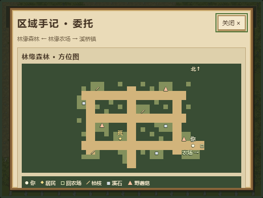
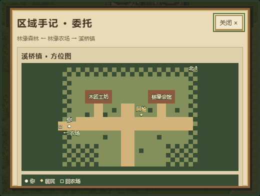

# 森林与小镇方位图 · 2026-10-20

森林和溪桥镇按 **L**，区域手记顶部会显示当前区域地图。上北下南；浅色是道路、深绿是障碍。圆点是玩家、菱形是居民、方框是回农场出口；森林还有枯枝、溪石和野蘑菇的独立标记及今日剩余数量。

地图打开时读取玩家当前位置和当日采集进度。已采点隐藏，睡到次日后恢复；关闭后移动再打开会更新位置。它仅用于查看，点击不会移动角色，去其他区域仍需沿地图道路步行。农场和室内保留原有区域摘要；地图下方仍可滚动查看地区说明与三项委托。L / Esc / 关闭按钮收起手记。

## 实现

- `areaMap.ts` 从真实 ExplorationMap、玩家像素坐标与 picked ID 创建纯展示快照；不写会话、地图或存档。
- `passagePathCells` 从原 AreaPassage 中抽取道路格选择，世界表现与方位图复用同一规则。保留农场 reserved 地块过滤、solid/grass 约束和旧田隐藏逻辑。
- `AreaMapView` 以原生 SVG 绘制地形和标记，用不同形状、中文图例与无障碍说明表达位置；没有交互处理器。
- TravelMenu 接受可选快照 getter，场景提供数据，沿用 PausePanel 的暂停、焦点、关闭与清理行为。

## 本机验收

2026-10-20，Node 24.17.0 / npm 11.13.0：接手基线657测试通过；本轮新增6项后 **40文件 / 663测试通过**，TypeScript和Vite构建通过（74模块），`git diff --check` 通过。保留既有 Phaser 大包提示，没有为此改拆包或依赖锁。

隔离 headless Chrome 使用真实 WASD/E/L/Esc 输入完成农场→森林→农场→小镇→农场；未设置角色位置或改个人浏览器存档。森林9资源与小镇2建筑、居民及出口一致。真实采 mushroom_c 后包内增加1蘑菇、体力100→98，地图相应标记消失、数量9→8；跨区保留物品/体力/采集记录。自然回农舍睡到第2天，体力恢复100、picked清空，重进森林地图恢复9/9与该标记。

打开手记后保持超过7秒时钟周期，日期/时间/体力/物品/金币/位置不变；尝试移动与点击地图仍留在本区，只有关闭按钮可聚焦。L/Esc恢复控制；3次重复开关各只有一个overlay、keydown-L和keydown-E各1个。农场、室内原手记及室内暂停兼容。稳定版本验收未观察到应用运行错误。细节见 `verification/area-map-checks.json`。

## 范围与限制

地图是打开时的当前区域快照，并不常驻。森林和小镇构图、NPC静态动作、其他季节素材仍可继续改善。本轮未验证长期经济平衡或全面跨浏览器兼容。新改动保留在本地 `feat/area-navigation` 分支，未commit/push/PR/发布；此前GitHub main仍是10月16日快照。
