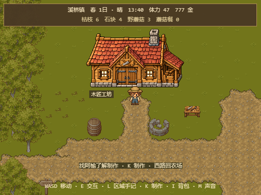
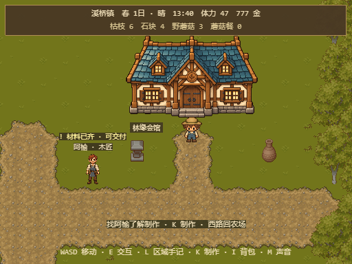
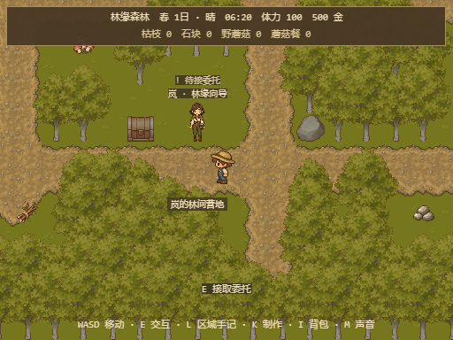

# 森林营地与小镇建筑打磨 · 2026-10-21

本轮继续改善测试版地图的可读性。保留原有种田、步行探索、任务和文件存档功能；工作仍在本地 `feat/area-navigation`，未提交或推送。

## 实际变化

- 森林入口、岚的营地和采集点下方局部清出32个原树/岩障碍格，保留450格树。原居民、9个资源、道具、道路、边界坐标不变，只增加内部通行空间。
- 岚身旁旧实心指示牌格改用物资箱显示，增加营地名称。草花由确定性布局选取，避开道路、居民和资源周边；不新增物理体。
- 木匠工坊使用红瓦、锯子标志和木料侧棚的原创素材；林缘会馆使用蓝绿屋顶与对称门廊。均按原足迹底边居中、192px宽等比显示。标牌放在门前路侧，避免遮住角色。
- 工坊旧箱子位置换成工作台，会馆旧箱格换成石灯；碰撞沿用原地图。附近未采资源有淡金色地面圈，采集后取消高亮。
- 独立的展示计划与场景装饰模块拥有明确清理流程。任一建筑素材缺失时独立回退原农舍，不影响另一栋正常加载的建筑。

## 画面

工坊晴天近景（正式构建、显式场景/位置夹具；建筑为游戏实际比例）：

会馆晴天近景（同类夹具）：

森林营地（实际从农场步行抵达）：

其他证据：`area-polish-forest-entry.png`、`area-polish-resource-focus.png` 是真实按键流程；`area-polish-{forest,town}-{rain,night}.png` 使用明确的日期、时间与场景/位置夹具。旧 `resident-ready-forest.png` 和 `walking-town.png` 仅作历史参考，本轮未声称同一会话的严格前后对照。

## 验证与边界

- 基线755项；最终45文件、774项测试通过，TypeScript/Vite正式构建79模块通过，`git diff --check` 通过。保留原有Phaser依赖大包提示，未据此随意拆包。
- 独立只读复核通过，复跑相关36项测试，未发现可操作缺陷。
- 隔离Chrome正式构建：真实WASD农场→森林→岚营地并E对话→农场→小镇→工坊门前。另从丰富V6雨天档真实走到 `mushroom_c` 并E采集：蘑菇3→4、体力47→45、采集ID追加；金币777、日期、木箱、旧田及委托保持。
- V6场景循环前后金币/背包/木箱/田地/任务/已采资源一致；V5迁移到V6保留旧字段，探索部分按既定默认值初始化。刷新可恢复。未访问用户浏览器档案。
- 三轮森林/小镇场景切换：静态体分别460/246、动态体均1、E/L监听各1、POST_UPDATE均2、装饰对象分别20/49，均稳定。退出森林后旧装饰对象数组清空。
- L手记7.2秒阻止时间和移动；真实资源采集后取消地面高亮。晴天、雨天和夜间画面已逐一检查。
- 拦截单独工坊素材：工坊回退、会馆保持新图；拦截全部v8：两栋均回退。两种情况下静态体246、无应用运行异常。完整原始记录见 [area-polish-checks.json](verification/area-polish-checks.json)。

原图由内置 `image_gen.imagegen` 生成，PNG字节未改；提示词、帧表、SHA-256与来源见 [v8/SOURCE.md](../public/farm-assets/original-addons/v8/SOURCE.md)。这些是缩小显示的高分辨率像素风插画，不是原生32px素材。建筑仍是外观，未新增建筑室内、居民作息或新的存档字段。

下一步优先补驻点居民的轻微待机动作与交互朝向，再分批统一其余季节作物素材。新动作应保持现有提示、驻点碰撞与任务规则。
