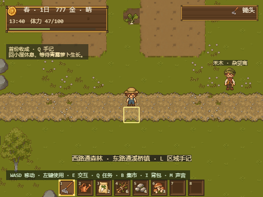
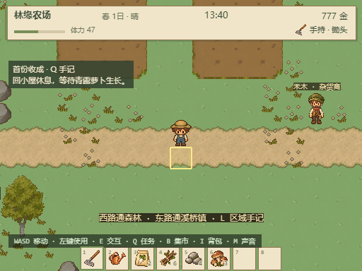
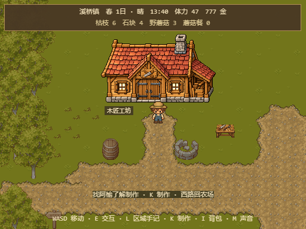
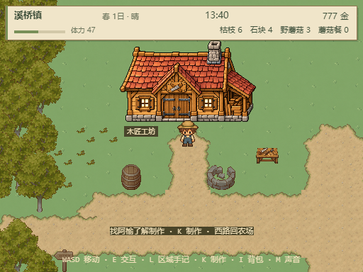

# 地表与界面美术规范 · 2026-10-21

本轮已落地草地、道路与HUD统一。方向是温暖田园像素风，以安静的绿色地表承托建筑、角色和作物。保留既有玩法和美术主体；本地改动未提交推送。

## 配色与比例

| 层次 | 颜色/规则 |
| --- | --- |
| 草地 | 鼠尾草绿，所选素材平均RGB约129/165/103；稀疏低对比小草纹，逻辑格32×32 |
| 道路 | 浅麦色主体、轻草边、少量小石点；连接帧和拓扑沿用原图 |
| HUD纸面 | `#f0e5c9`，细边`#927652`，绿色强调`#788f58` |
| HUD文字 | 正文`#3f503b`、次要`#69725a`；地区13px、主要数字12–13px、次要10–11px |
| 任务提示 | 深绿底、奶油文字；11px中文字体、3px额外行距，避免旧版两行拥挤 |
| 尺寸层次 | 建筑/角色/作物尺寸保持；HUD48px高、快捷栏8格各32px，保留游戏视野与原输入 |

后续补图遵循：地面少噪点、物件轮廓清楚、亮度相近的地表变体、温暖但不过黄。生成图需要在512×384实际画布检查。不要用大图精细程度代替32px验收。

## 同机位对照

正式构建、隔离Chrome、同一显式V6晴天夹具（第1天13:40、777金、47体力、原作物/背包）。农场使用默认出生机位；小镇使用相同的场景/位置夹具(288,308)。

| 农场改前 | 农场改后 |
| --- | --- |
|  |  |

| 工坊改前 | 工坊改后 |
| --- | --- |
|  |  |

第一版新草纹在缩小后仍显密，已用内置imagegen做简化，最终采用meadow-v2。HUD将地区/日期天气/时钟/金币分列，下行体力与当前物品或材料；农场快捷栏和标题按钮同步采用纸面色。选中槽位仍用原8格位置和图标，新增绿色选框。室内和探索场景共用同一面板。

## 渲染合同

- `groundVisual.ts`复用HasVisualFrame纯选图模式。草地3帧、道路9帧完整才启用；任何新帧缺失整套回退，草/路分别判断。原素材键不覆盖，独立Cainos展示页保持。
- 环境、土壤透明边缘和标题共用草图公式；农舍门前、探索道路和跨区路口共用道路选图。土壤边界、旧田避让、道路拓扑与实体碰撞保持。
- `SceneHud`只接收显示快照，不读取或修改会话/存档。三场景退出时销毁12个自有图元。每栏独立限宽，大数值不会压缩整行其他信息。
- 现有季节tint、昼夜/风雨层和前轮原创建筑保留。冬季目前仍是色调变化，尚无积雪地表；本轮不等于整套四季美术完成。

## 验收

- 基线774项；最终47文件**783项测试通过**，TypeScript/Vite正式构建81模块通过，diff检查通过。新增7项选图回退合同测试先观察失败再实现，2项原图/帧表测试；纯视觉位置与颜色用实际画面验收，未添加镜像测试。保留原Phaser依赖大包提示。
- 独立只读复核未发现明确缺陷，相关34项测试通过。后续草纹选择与提示行距调整均做了最终构建和实机检查。
- 检查春1/夏15/秋29/冬43日：环境与土壤底图均选meadow-v2且tint完全相同；另检查第6天雨天森林、21:00小镇与小屋。
- 最大有效夹具：day1,000,000、gold1,000,000,000、22:00、体力0，所有HUD文字边界在面板内。3号种子槽的图标、中文名称与选框位置对应，8格保持。
- 隔离夹具中实际1/2/3+点击完成`11_12`开垦、浇水、播种；`8_12`旧萝卜growthDay2保持。实际WASD农场→森林→农场→小镇后金币/日期/背包/木箱/田地/任务/已采状态一致。
- 三轮森林/小镇切换：HUD图元12、E/L监听各1、动态体1、POST_UPDATE2；静态体分别460/246，全部稳定。退出小屋后旧HUD图元数组清空，I背包正常。
- 浏览器删除新草c/新路ne帧后，整套草/土壤底图/路均回退旧图。拦截草地文件时草与土壤同步回退、道路保持新图；拦截全部v9时全部回退。无应用运行异常。

证据：[art-design-checks.json](verification/art-design-checks.json)、`screenshots/art-design-*.png`。一次过长的测试工具批次触发30秒超时，测试浏览器自动关闭；已分批重跑并逐步保存场景清理证据，该超时不是游戏异常。

素材由内置`image_gen.imagegen`生成，选定PNG、所有提示词、SHA-256与来源见 [v9/SOURCE.md](../public/farm-assets/original-addons/v9/SOURCE.md)。原PNG字节保持，静态帧表裁切与游戏缩放负责显示。后续可沿此规范继续统一人物待机表现、田地边界和其余季节作物。
