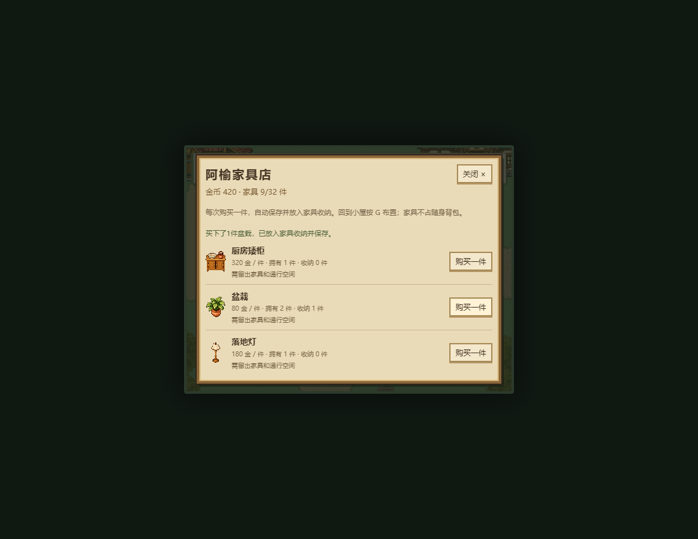
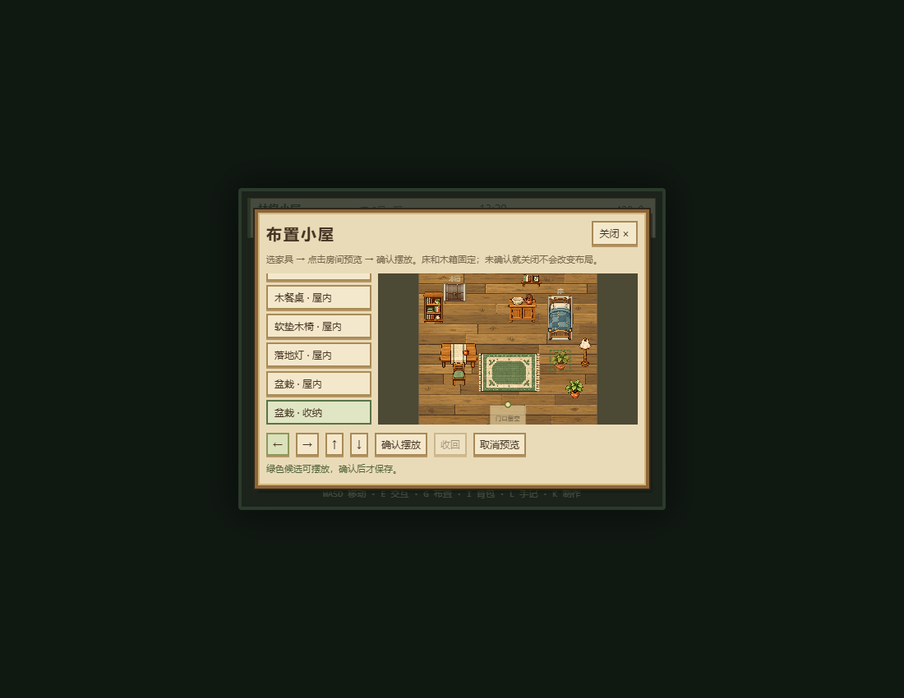

# 阿榆家具店与小屋布置 · 2026-10-23

用户批准按上一轮建议推进。本轮完成第一阶段“购买家具→回家布置→保存”，接续 [固定家具美术轮](HOME_FURNITURE.md)，保留所有前轮未提交工作，没有提交、推送或发布。

## 怎么玩

1. 步行到溪桥镇，靠近阿榆按E，选择“看看家具 · 阿榆家具铺”。八种家具按件出售，显示余额、拥有/收纳数。购买后自动保存并进入独立家具收纳，不占工具和种子背包。
2. 回小屋按G。左边选一件家具，右边点击房间预览位置；用箭头按钮微调。绿框可确认，红框说明越界、重叠、挡住角色或床箱门通道等原因。
3. 确认摆放才会改变实际房间和存档；“收回”保留这件家具供下次再摆。取消预览、G或Esc关闭均放弃未确认位置。

最多拥有32件，床和木箱固定，地毯可与家具叠放，壁架只能挂北墙。现有八件和旧布局作为初始家具保留；额外同款需购买。当前没有旋转、出售、退款或房屋扩建。

| 阿榆家具店 | 小屋预览 |
| --- | --- |
|  |  |

## 规则与存档

- 家具定义/价格/初始布局在data层，纯FurnitureService负责稳定实例ID、收纳和统一几何校验。玩家按原32×28矩形校验整条通路，保护回屋落点、床箱操作站位、门口及当前角色；移动时仅忽略自身旧脚印。
- GameSession购买、摆放和收回包装为事务，主档或备份写入失败回滚家具与金币，保留服务引用和时钟余量。预览无领域修改/写档。HomeDecor只重建已确认的显示与碰撞，旧碰撞关系和对象显式销毁。
- 完整存档升级V7，家具实例与位置随金币、作物、背包、木箱、日常和委托一起保存。V1–V6按各自原字段严格迁移，保留原八件家具；非法V7布局不重置绕过校验，V8及未来版本受保护。
- 原文备份、文件导入预览/确认、导出和持久导入前副本沿用原合同。文件预览使用SAVE_VERSION，明确家具也随存档恢复。
- 复用现有v11 atlas，不新增素材或依赖。新家具素材缺失时不产生隐形碰撞，预览保留可操作的示意轮廓。

## 验收

基线57文件918测试；新增领域34项、V7存档42项、会话事务7项，最终**60文件1001测试通过**。TypeScript/Vite92模块正式构建、diff检查通过；保留原有Phaser大包提示。旧测试的当前/未来版本断言同步为7/8，真实V1–V6夹具和全部坏数据/原文保护断言保留。

独立只读复核未发现阻断交付的重要缺陷，相关5文件90项测试通过。主Agent另外做隔离Chrome、合成V6和V7进度的真实键鼠验收：

- 正常标题Enter读取V6；原500金、作物/探索保留并补八件家具。阿榆E对话打开店，买盆栽扣到420金，新增第9件未摆放实例，原背包不变。
- 小屋G→第9件→点门口，确认按钮禁用；合法候选显示绿框。预览和取消保持主档原字节不变，确认位置与面板候选完全一致。鼠标像素转换会按实际画面取整，后续微调和保存均使用同一候选坐标。
- 收回保留实例9且位置为null；重新摆放主档写入失败时原文和家具不变，提示可重试；恢复写入重试成功。商店备份写入失败也保持420金、实例与主档不变。
- 菜单打开7.3秒后分钟/体力不变、物理暂停且场景键盘禁用。三轮微调/确认/关闭后静态体9、colliders9、家具9、G监听1、DOM菜单0；旧装饰图元/碰撞数组清空。
- 刷新恢复实例位置。标题S真实下载V7文件，在另一空白浏览器上下文上传/确认导入，恢复家具9、420金、种子5、箱树枝4、原作物growthDay1、已采wood_a与委托状态；小屋渲染静态体9。
- 合成余额0时八个购买按钮均禁用；合成32件/9999金时也均禁用并明确容量限制。阻断v11图集后仍可G操作布局并保存，家具实例9保持、场景只剩床箱2个碰撞体。
- 最终三个验收上下文无页面运行异常。最初测试脚本曾按期望点击坐标断言，随后改为读取实际面板候选验证提交一致；导入后等待标题重建再Enter。以上是测试驱动时序调整，没有据此修改游戏规则。
- 补验两张重叠地毯和床前高书架：预览与实景均保持地毯实例顺序258→260，床depth10.02、书架10.0232，书架在床前正确遮挡。预览与实际共用稳定的地面/脚底排序；独立补验上下文也无页面异常。

证据：[结构化结果](verification/furniture-play-checks.json)、[操作面板](screenshots/furniture-play-layout-panel.png)、[拒绝门口](screenshots/furniture-play-blocked.png)、[保存失败](screenshots/furniture-play-save-failure.png)、[文件迁移](screenshots/furniture-play-transfer.png)、[已恢复小屋](screenshots/furniture-play-room.png)。

实机使用开发服务5177及临时浏览器配置；场景切换/站位是显式夹具，实际E/G/T/S、点击、购买、摆放和文件下载上传走真实UI。没有读取个人浏览器存档，没有声称生产服务实机或全面跨浏览器验收。后续路线仍是每日订单与金币用途、居民生活和季节节奏，本轮未加入这些系统。
