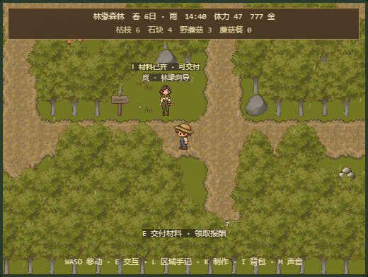

# 任务引导、存档迁移与居民提示 · 2026-10-20

本轮按用户自主推进授权，在上一轮方位图上继续开发，三个单元均已本地实现和验收。工作目录W:\codex\lingjing-farm，分支feat/area-navigation；本轮未commit、push或发布。

## 玩家能看到的变化

- 农场HUD与Q手记根据真实田地和背包提示：领取、播种、浇水、等待、收获、交付。目标作物尚未收获时，不再统一要求找禾木交付。
- L区域手记保留方位图，下方三委托分别显示随身材料数量、就绪状态、下一步与地点。木箱内物品会提示先取出；完成后显示历史已交付数量，避免扣完材料却显示“已完成0/3”。
- 岚、阿榆头顶区分待接取、收集中、可交付与已完成；靠近后E提示与材料就绪一致。居民仍静态驻点，本轮没有制作新动画或作息。
- 标题页按 **S** 或点击“存档管理”，可导出当前存档，或选择JSON文件预览后确认导入。S/Esc/关闭会取消尚未确认的操作。

## 换电脑带走进度

1. 在游戏中按T保存回标题，再按S打开存档管理。
2. 点击“导出当前存档”，浏览器下载`lingjing-farm-day-N.save.json`。
3. 将文件带到另一台电脑，在那里打开游戏标题，S→选择文件。
4. 检查日期、金币和版本，再点击“确认导入并替换”。回到标题后Enter继续。

导入会恢复金币、日期、时刻/体力、背包、木箱、田地/作物、三项任务、采集状态与提灯；仍不保存精确角色位置或所在区域，进入游戏从农场继续。声音设置独立于游玩档，不随文件迁移。

已有主存档被导入替换前，原文会另存为导入前副本。普通自动保存不会覆盖它。需要找回有效旧进度时，S→“导出导入前备份”，再选择下载的文件预览并确认导入。该副本保存最近一次“替换已有主档”前的状态，不是无限历史；向空主档导入不会删除已有副本。损坏/未来版本的旧主档也保留原文记录，但当前版本无法将其作为有效游戏存档导出或恢复。

预览与导出均不写游玩数据；文件超过256KiB、内容损坏、未知未来版本都会拒绝。预览后另一页面改了当前主档，确认会要求重新选文件。保留副本失败或主档写入失败，不替换原主档。导入使用现有V1–V6严格校验；旧版文件仅在明确确认时写为V6。

## 实现与边界

- `objectiveGuide.ts`为纯展示模型，读取既有GameSession服务；不存储教程进度，不修改任务规则。成熟与再生成长沿用CropService；只有目标作物影响首收提示。
- HUD/Q/L/居民共用目标与材料就绪推导。雨天不重复要求浇水，多阶段混合田保留次要浇水说明。
- 现有规则允许背包/木箱中已有种子跨季播种；本轮保留该规则，仅缺种且商店不售时提示等待适种季节。
- SaveManager新增previewImport/importSave/exportSave/exportImportBackup，复用原严格校验；确认时重新校验并比较预览时的主档原文。
- 主档仍使用V6。新增的localStorage键`four-seasons-farm/save/before-import`只存导入前原文，不进入SaveData结构。正常自动备份与rejected记录仍保留。
- SaveManagementMenu复用PausePanel；文件读取用generation校验，关闭、取消或重新选文件后，旧异步结果不会回填。Tab焦点循环包含文件输入。

## 本机验证

Node24.17.0/npm11.13.0；**42测试文件、755项测试通过**，TypeScript与Vite生产构建通过（76模块），git diff --check通过。保留既有Phaser大包提示，没有宣称性能优化。独立审查复跑92项引导/迁移测试，无阻断；发现并修正文案：只有有效导入前副本能导出。

验收在独立headless Chrome context和正式构建预览127.0.0.1:5176进行，未读取用户浏览器或个人存档。丰富V6数据与写入失败/异步延迟属于明确测试夹具；角色移动和交付使用真实键盘/按钮，未注入位置或直接完成任务。

- 实际下载文件，再在另一个无数据context上传、确认、继续、刷新，完整数据逐字段一致。
- 空存档导出提示、预览零写入、取消零写入、损坏JSON/负金币/未来V7/超限文件、预览后存档变化、主档写入失败保护通过。
- 延迟文件读取期间关闭再打开，无旧预览残留；后选文件先完成时，先选文件结果不会覆盖；Tab能进入文件输入并循环。
- 导入后正常进入游戏、等待自动保存、T再保存后，普通backup已更新，before-import仍是原777金币进度；实际导出副本字节一致，重新选择显示777预览，取消后仍是当前888进度。
- 首收夹具的2/4成长、雨天和背包0/1，HUD/Q/L均提示等待而非交付；L两探索任务按3/3、6/6+4/4显示可交付。
- 真实步行到森林岚身边交付后金币777→857、蘑菇3→0、提示改已完成，重开无交付按钮；沿道路去小镇找阿榆，交付树枝6与溪石4后金币857→997，提示与手记均更新。回农场、刷新保留进度。
- 完成后的L手记改为“已交付：野蘑菇×3／树枝×6·溪石×4”。稳定版本无应用运行错误。

证据：`verification/guidance-save-checks.json`及本页截图。测试下载文件和浏览器数据位于工作区外层专用QA目录，不进入项目仓库。

## 下一步

接着做森林入口/营地与木匠工坊局部构图样板，先比较昼夜与雨天的画面可读性，再扩大到全区。保护资源稳定ID、已有作物、道路和存档；需要改碰撞时另外验收可达性。居民动画、其他季节作物与持续委托仍未实现。
