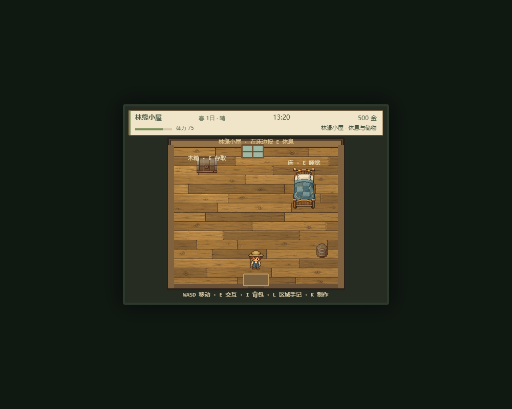
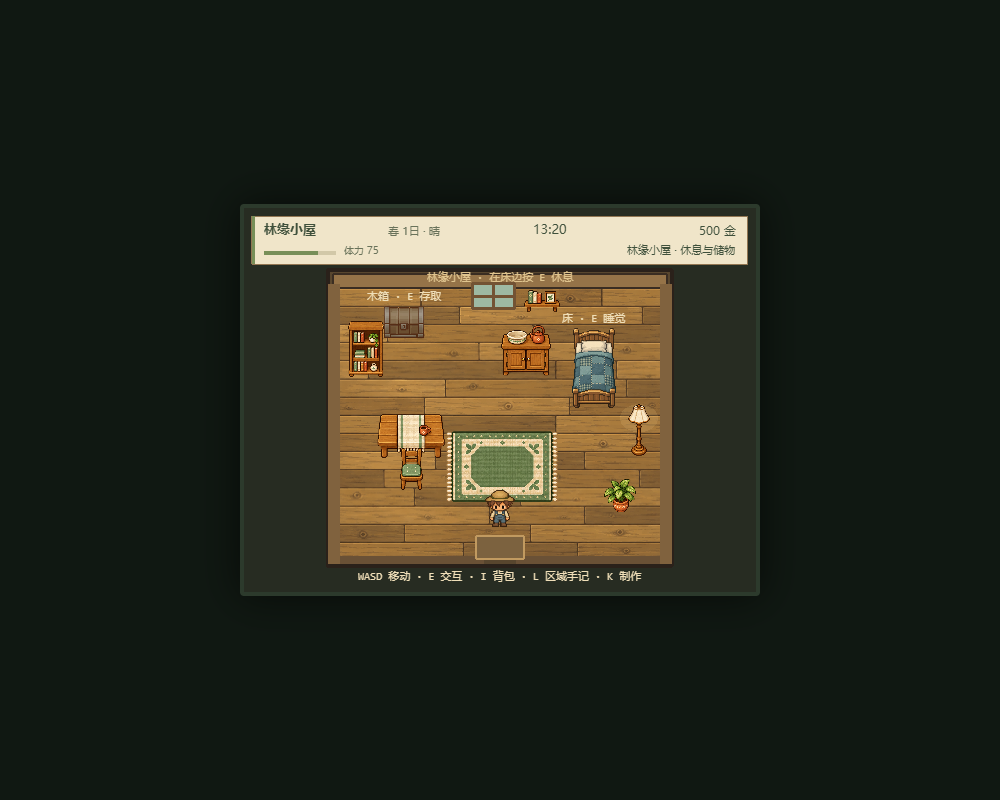

# 小屋家具与布局 · 2026-10-23

后续购买、自由摆放/移动/收回和V7家具存档已完成，当前玩法见 [FURNITURE_PLAY.md](FURNITURE_PLAY.md)。本文保留前一轮固定家具的历史验收。

用户同意先丰富固定布局，并授权自主决定推进。本轮在现有本地未提交工作上增加家具，不改变经营数据或V6，不提交/推送。

## 实际结果

新增八件配套家具：木餐桌、软垫木椅、书架、带水盆与陶壶的矮柜、盆栽、落地灯、地毯和带书/植物画的壁架。西北储物、北侧橱柜、左侧起居、东北睡眠、右侧灯与绿植；移除东南旧木桶，中轴和门前保持可走。家具当前是固定装饰；没有购买、拖动、旋转、坐下或厨房功能。

| 改前 | 改后 |
| --- | --- |
|  |  |

原小屋320×272、床350/160、木箱160/130、出生256/304保持。床箱增加正确脚底层级；实际箱子atlas pivot为originY=1，碰撞体仍为x140/y98/w40/h32，箱标签上移到y88，避免被箱体遮挡。

## 实现与素材

`homeFurniturePlan.ts` 负责纯只读布局和可选帧选择；`HomeDecor.ts` 负责等比缩放、脚底层级、六件实体的静态脚印和碰撞关系。地毯/壁架无碰撞；灯具低透明局部光晕是静态装饰。按原玩家32×28做通道检查，不用图片透明边当碰撞范围。

独立v11 atlas使用内置imagegen生成。原PNG保持，JSON裁切八件家具，来源、全部提示词和SHA-256见 [v11/SOURCE.md](../public/farm-assets/original-addons/v11/SOURCE.md)。这不是原生32px图集；按512×384实际画布验收。

没有整张atlas或单件帧时，跳过对应新图与碰撞，不产生不可见障碍；保留旧床/箱。退出销毁所有自建图元/静态体/碰撞关系，不移除共用纹理。不修改domain、save或Player；这些文件当前已有diff属于前轮工作。

## 验收证据

- 基线54文件906测试；本轮新增12项，最终57文件918测试通过。TypeScript与Vite87模块正式构建通过，保留原有Phaser约1.2MB分包提示；diff检查通过。
- 新测试覆盖全角色尺寸下出生至床/箱/门连通、中轴通道、实体阻挡/地毯可走、atlas范围、单帧/整套缺失、加载幂等、缩放及资源销毁。
- 隔离Chrome、合成V6进度，实际WASD向桌边走停x217，向椅子停x195，从256/304向上跨过地毯到y221.33。E打开木箱，按钮存1种子4+1、取回5+0，箱内4树枝保持。
- E床边休息从第1天到第2天，作物growthDay1→2、体力75→100，保存后刷新Enter继续，田地、种子5、箱树枝4保持。
- 实际S走出门、农场E返回，连续3轮：每轮静态体8、动态体1、colliders8、图元47、E监听1、POST_UPDATE2、DOM菜单0；旧装饰图元/碰撞关系数组均清空，共用atlas保持。
- 晴天及第6天雨夜21:00截图通过；桌后角色depth10.0218低于桌10.025，桌前角色10.0282高于桌。床箱标签无家具遮挡。
- 删chair帧重启后剩7件/7静态体，无椅子隐形阻挡；阻断v11文件请求时新家具0、静态体2、colliders2。合成旧V1档第14天/777金仍可床E跨夏15日并保存为V6，木箱锄头存取正确，金币保持。
- 最终验收上下文无页面运行异常。一次初始测试夹具错误地并行启动标题和小屋，已改为正常Enter进入农场，再通过场景局部start切到小屋，完整重跑通过；此前Vite热更新/临时文件监视问题不作为产品验收证据。

结构化结果见 [home-furniture-checks.json](verification/home-furniture-checks.json)。截图另有 [雨夜](screenshots/home-furniture-night.png)、[木箱](screenshots/home-furniture-chest.png)、[缺图](screenshots/home-furniture-fallback.png)、[角色在桌后](screenshots/home-furniture-depth-behind.png)、[角色在桌前](screenshots/home-furniture-depth-front.png)。

实机验收使用开发服务5177及隔离临时配置，没有读取用户个人档；没有声称做过生产服务实机或全面跨浏览器测试。尚未测试玩家主角色图集也缺失的组合场景。后续可在此家具美术和通道基线上设计购买、摆放和布局存档。
